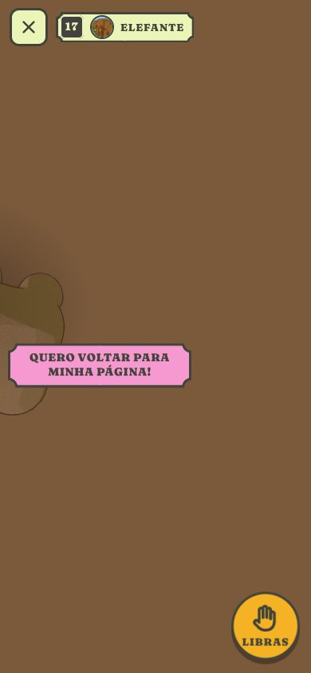
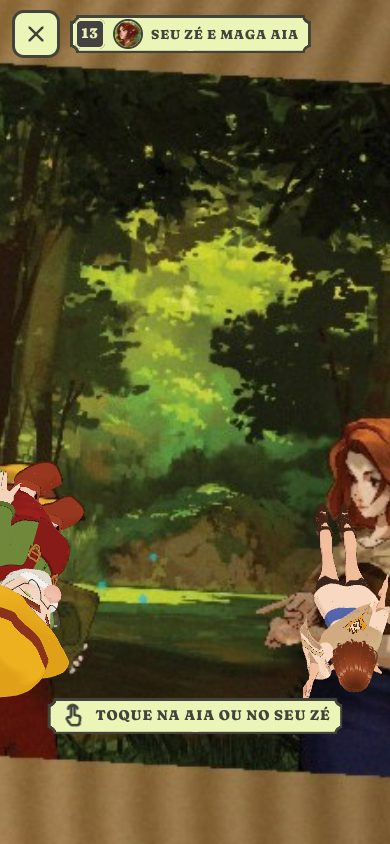
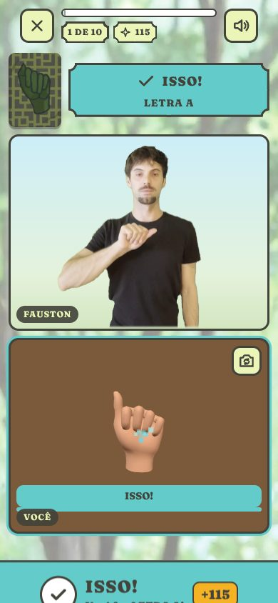

# SinalizaAção: Animais em Voga — WebApp de Realidade Aumentada

O app que dá vida ao livro *SinalizaAção: Animais em Voga* (InclusiVR), para
crianças de 3 a 8 anos — muitas ainda sem saber ler. Roda no navegador do
celular (Android e iPhone), sem instalar nada.

- **LIVRO** — aponte o celular para uma página com AR: o animal (traço do Igor
  Bucioli, em 3D) **salta do desenho**, fica feliz e **passeia pela página**.
  Tocar nele é **carinho**. Se a página some da câmera, ele **pisca, fica
  transparente e pede "QUERO VOLTAR PARA MINHA PÁGINA!"**. O botão **LIBRAS**
  chama o **Fauston**: **SINAL DO ANIMAL** (repete quantas vezes quiser) e
  **SOLETRAR O NOME** (cada letra destacada em sincronia, como karaokê). Nas
  páginas sem animal em AR, a **Maga Aia** e o **Seu Zé** acenam, ficam
  felizes, andam e respondem ao toque.
- **JOGOS**:
  - **Jogo de Cartas** — o jogo mostra o animal (ou a letra) e a criança acha,
    entre as cartas com a face de LIBRAS para cima, **o sinal que combina**.
    Embaralha **uma vez por partida** (com semente); errar não tira pontos.
  - **Zoológico do Seu Zé** — caixa de areia: colocar, tirar e aproximar os
    5 animais do livro e as runas das vogais, e ver o que acontece (o urso
    come o mel da abelha, o elefante joga água, a onça brinca, a runa acende
    quando o seu animal chega).
  - **Sinalize!** — o Fauston faz o sinal **duas vezes**, e a criança repete
    para a **câmera frontal**; reconhecido a tempo = pontos.

Tudo no navegador: [MindAR](https://github.com/hiukim/mind-ar-js) (imagens),
[Three.js](https://threejs.org/) r160 (3D), [three-vrm](https://github.com/pixiv/three-vrm)
2.1 (Aia e Seu Zé) e [MediaPipe](https://ai.google.dev/edge/mediapipe) (mãos).
Visual: **Telas do Signária** do design system InclusiVR.

| Início | Instruções | Elefante na página | LIBRAS: soletrar |
|---|---|---|---|
|  |  |  |  |

| Quero voltar! | Aia e Seu Zé | Jogo de Cartas | Zoológico | Sinalize! |
|---|---|---|---|---|
|  |  |  |  |  |

O que mudou na atualização de novembro de 2026, a análise feita antes e o que
depende de material: **[docs/ATUALIZACAO-2026-11.md](docs/ATUALIZACAO-2026-11.md)**.

---

## 1. Como abrir

**Publicado:** a câmera só funciona em `https://`. Com o GitHub Pages ativado
(seção 11), a raiz redireciona para `inclusiapp/`.

**No computador, para desenvolver:**

```bash
npm install
npm start            # http://localhost:8080/inclusiapp/
```

## 2. Estrutura

```text
inclusiapp/
├── index.html                 telas (início, livro, jogos) + ícones de linha (SVG)
├── sw.js                      service worker (VERSION: aumente ao publicar mudanças grandes)
├── src/
│   ├── config.js              ★ animais, páginas do livro, personagens, pares das cartas, AR
│   ├── main.js · router.js    rotas: #/ #/livro #/livro/ar #/sala #/cartas #/cartas/jogar #/zoo #/sinalize #/sinalize/jogar
│   ├── ar/
│   │   ├── arSession.js       câmera + MindAR + Three.js (renderer único do app)
│   │   ├── targets.js         alvos .mind comprimidos, com verificação
│   │   ├── bookAR.js          o livro (um modo só): páginas → animais/personagens + LIBRAS
│   │   ├── pageActor.js       a vida na página: saltar, passear, carinho, "quero voltar"
│   │   ├── pageWalker.js      o passeio dentro da página (sem DOM — testado)
│   │   ├── modelManager.js    animais .glb (meshopt) e as animações gravadas
│   │   └── videoChroma.js     vídeo do Fauston sem o fundo verde (trechos)
│   ├── characters/characterModel.js   Aia e Seu Zé (VRM): olá, feliz, andar, preocupado
│   ├── libras/
│   │   ├── librasVideos.js    ★ tempos de cada letra e do sinal em cada vídeo
│   │   └── librasPanel.js     o módulo do Fauston (SINAL / SOLETRAR em karaokê)
│   ├── game/                  Jogo de Cartas (gameState.js = regras, random.js = semente)
│   ├── zoo/                   Zoológico (zooConfig.js ★ interações da história, zooState.js = regras)
│   ├── sign/                  Sinalize! (signConfig.js ★, signRecognizers.js, handSigns.js...)
│   ├── ui/                    menu, jogos, instruções, avisos, sons, faíscas
│   └── styles/                tokens.css (design system) · signaria.css (componentes) · app.css (telas)
├── assets/
│   ├── models/*.glb           os 5 animais (repositório inclusivr-animais)
│   ├── personagens/*.vrm      Maga Aia (inclusivr-aia) e Seu Zé (inclusivr-personagens)
│   ├── targets/               paginas.mind (9 páginas) e cartas.mind (20 faces)
│   ├── img/                   arte final do Igor e do design system, em WebP
│   └── fonts/                 Fraunces Soft (substituta livre da Cooper; OFL)
├── vendor/                    MindAR 1.2.5, Three.js r160 (+ meshopt, KTX2, SkeletonUtils), three-vrm 2.1.0, MediaPipe 1.0.1
└── cartas/ pag/ videos/ exemplo/ codes/      arquivos originais
tools/                         servidor, compilador de alvos, imagens, medição dos vídeos de LIBRAS, visualizador de modelos
tests/                         testes de unidade, de reconhecimento e ponta a ponta
```

## 3. Configuração central — `inclusiapp/src/config.js`

- `ANIMALS`: cada animal com modelo, retrato (recorte da ilustração do Igor),
  as duas faces da sua carta (`picture` e `sign`), as animações e a letra.
- `BOOK_PAGES`: **as páginas que têm AR** — alvo no `paginas.mind`, número da
  página no livro, quem aparece e onde está desenhado (`home`, de onde ele
  salta). Cada página é uma lista de "camadas"; a leitura da história pela Maga
  Aia (plugin de LIBRAS) pode entrar depois como outra camada.
- `CARD_PAIRS`: os 10 pares do Jogo de Cartas (o que o jogo mostra → a face de
  LIBRAS que a criança precisa achar).
- `BOOK`, `LIBRAS` (chroma key), `GAME` (pontuação), `AR` (rastreamento).

| Página do livro | Alvo | Quem aparece |
|---|---|---|
| 15 | 0 (`pag/Pagina1.png`) | Abelha |
| 17 | 1 | Elefante (o da lagoa, com o reflexo turquesa) |
| 19 | 2 | Iguana |
| 21 | 3 | Onça |
| 23 | 4 | Urso |
| 10, 13, 24, 25 | 5 a 8 (`pag/Pagina6.jpg` a `Pagina9.jpg`) | Seu Zé e Maga Aia |

A **runa** (a página da esquerda, com textura) não tem AR: o reconhecimento é
pelo desenho do animal, na página ao lado. As cartas recortadas têm AR só nos jogos.

## 4. Os animais, a Aia e o Seu Zé

- **Animais** (`inclusivr-animais`, aprovados em 29/10/2026): `.glb` leves
  (malha e animações com meshopt, textura WebP), material sem luz com a pintura
  do Igor. Animações gravadas: `parado`, `andar` (a abelha: `voar`), `feliz` e a
  especial — `agua` (elefante), `crista` (iguana), `brincar` (onça), `mel`
  (urso). O app não troca o material; toca os clipes com `AnimationMixer`.
- **No livro** (`pageActor.js`): salta do desenho (`feliz`), passeia sem sair
  da página e espia a beirada; toque = carinho (`feliz`), a cada 3 toques a
  especial. Sem a página: fica parado onde estava, pisca, fica transparente e se
  preocupa (`BOOK.lostGraceMs`). Se o arquivo ganhar um clipe `preocupado`, ele é
  usado sozinho; até lá, o efeito é feito por código.
- **Aia e Seu Zé** (VRM 1.0, três-vrm): as animações são feitas nos ossos do
  esqueleto (`characterModel.js`): olá, feliz, andar, preocupado, piscar. A Aia
  leve usa texturas KTX2 (Basis), lidas pelo `KTX2Loader` (só baixado quando ela aparece).

Para trocar um modelo: copie o novo `.glb` para `assets/models/` com o mesmo
nome (o contrato está no `docs/ENTREGA.md` do `inclusivr-animais`) e confira em
`tools/model-viewer.html`.

## 5. LIBRAS com o Fauston

Cada vídeo (`videos/<animal>.mp4`) tem a **soletração** e depois o **sinal**
(gravado 2 a 4 vezes). `src/libras/librasVideos.js` guarda onde começa e
termina cada letra e o sinal. Os tempos foram medidos com
`node tools/medir-libras.mjs` (o reconhecimento de mãos acha as pausas da mão)
e conferidos quadro a quadro. **Falta o Fauston conferir** (`conferido: false`).

- O módulo só aparece pelo botão **LIBRAS**, nas páginas com animal.
- **SINAL DO ANIMAL** toca só o trecho do sinal; **DE NOVO** repete.
- **SOLETRAR O NOME** toca a soletração e destaca a letra da vez (âmbar); as
  anteriores ficam ciano e as próximas, de pedra.
- O chroma key do fundo verde-limão está em `LIBRAS.chroma` (seção 7 do histórico).

## 6. Alvos do MindAR (páginas e cartas)

```bash
npm run targets          # compila páginas e cartas (lê as pastas pag/ e cartas/)
npm run targets -- paginas
```

Reconhecimento medido com o detector real do MindAR em fotos sintéticas
(`python3 tests/make_frames.py` e `node tests/e2e/recognition.mjs`):

| Conjunto | Resultado |
|---|---|
| 9 páginas × 4 situações (de frente, inclinada, longe, escura) | **100% (36/36)**, 0 confusões |
| 4 páginas da Aia e do Seu Zé com uma cartela de texto simulada por cima | **100% (8/8)** |
| 20 faces das cartas | 98,8% (medição anterior) |

As páginas 10, 13, 24 e 25 foram feitas das **ilustrações do Igor sem as
cartelas de texto**. Conferir com o livro impresso; o ideal é exportar as
páginas da diagramação final (troque `pag/Pagina6.jpg`... e rode `npm run targets`).

## 7. Jogo de Cartas

As cartas físicas têm duas faces: o desenho (animal ou letra) e o sinal em
LIBRAS. O jogo mostra uma face e pede a **outra face da mesma carta** — a
criança precisa relacionar o animal ao seu sinal, não achar a mesma imagem.

- Dica na tela: deixar todas as cartas com o **lado do sinal para cima**.
- Mostrou o desenho do mesmo par? "VIRE A CARTA!". Outra carta? "QUASE!" (sem perder pontos).
- Acerto: 100 pontos + até 50 de rapidez; "ISSO!" e o próximo desafio na hora.
- Embaralha **uma vez** no começo (semente nova a cada partida; a ordem fica
  fixa e continua igual se o jogo for retomado). 10 desafios; resumo com 1 a 3 estrelas.

## 8. Zoológico do Seu Zé

Substitui o antigo Bichinho Virtual (que tinha regras demais para 3–8 anos).

- **Colocar**: toque num animal ou numa runa da bandeja. **Mover**: arraste.
  **Carinho**: toque no animal. **Tirar**: arraste até a lixeira. Até 12 de uma vez.
- **Necessidades** em balões com ícones, sem barras: o urso sente **fome de
  mel**; os outros **querem brincar**; depois aparecem **feliz** e **satisfeito**.
- **Interações** (`src/zoo/zooConfig.js`, só o que a história mostra):
  urso + abelha → a abelha voa até ele e o urso come mel (pág. 23); o elefante
  joga água em quem chega (pág. 17); a onça brinca (pág. 21); outros encontros =
  os dois ficam felizes (pág. 24); **o animal perto da runa da sua vogal** → a
  runa acende em turquesa e ele faz a animação especial.
- O zoológico fica salvo no aparelho (`localStorage`, chave `sinalizaacao:zoo`).

## 9. Sinalize!

```text
carta na tela → OLHE: o Fauston faz o sinal 2 vezes → 3, 2, 1 → SUA VEZ (câmera frontal)
→ reconhecido a tempo: ISSO! + pontos → próximo (ordem fixa por partida, com semente)
→ não deu em 15 s: QUASE! → TENTAR DE NOVO (vê o sinal de novo) ou PRÓXIMO
```

- 10 desafios: as 5 vogais e os 5 animais. As vogais usam a primeira letra da
  soletração de cada animal (A de ABELHA...).
- Câmera **frontal** por padrão, espelhada; botão para trocar. Sem esqueleto da
  mão na tela e sem termos técnicos.
- **SEM CÂMERA**: a pessoa confirma com ERREI · ACERTEI (a câmera nunca é obrigatória).
- **Vogais**: classificador da configuração de mão (`handSigns.js`) + juiz de
  vários quadros (`signJudge.js`). Foi ajustado para também reconhecer o E e o O
  do Fauston (o polegar dele fica em outra altura que na mão 3D de teste).
- **Animais (reconhecimento simplificado, provisório)**: `signRecognizers.js`
  tem uma regra por sinal com o que mais o marca (quantas mãos, mão aberta ou em
  "F", altura e movimento). Nos vídeos do Fauston, cada regra aceita o seu sinal
  e recusa os outros quatro e todas as soletrações. **Uma pessoa só não basta**:
  precisa ser testado com crianças; o reconhecimento completo pede um modelo
  treinado (Signária IA), que entra no lugar com a mesma interface.

## 10. Visual e acessibilidade

- **Telas do Signária** (design system InclusiVR): plaquinhas de pergaminho com
  cantos recortados e contorno tinta, botão principal âmbar embaixo, ciano para
  acerto e progresso, rosa para dica e "quase", Fraunces Soft, fundo com a
  floresta esmaecida do Igor. **Sem emoji**: ícones de linha no `index.html`.
- **Para quem ainda não lê**: cada instrução tem ícone e imagem; os jogos
  começam com uma demonstração em passos visuais; os retratos dos animais e as
  runas são a arte do Igor. Os textos continuam lá para quem lê e para os adultos.
- Leitores de tela (anúncios), foco visível, alvos de toque grandes, "reduzir
  movimento" respeitado, retorno visual de todo som.

## 11. Publicar no GitHub Pages

**Settings → Pages → Deploy from a branch** → a branch e a pasta **/ (root)**.
Ao publicar mudanças grandes, aumente `VERSION` em `inclusiapp/sw.js`.

## 12. Testes

```bash
npm test                         # 86 testes de unidade
python3 tests/make_frames.py     # (opcional) fotos sintéticas das páginas e cartas
node tests/e2e/recognition.mjs   # reconhecimento real das páginas e cartas
npm run test:e2e                 # ponta a ponta no Chromium (telas, livro, personagens, cartas, zoo, sinalize, erros, paisagem)
npm run test:e2e -- livro        # só uma parte
```

Os testes ponta a ponta usam uma **câmera falsa** (`tests/e2e/fakeCamera.js`):
o caminho real (câmera → MindAR/MediaPipe → 3D → LIBRAS) roda no navegador.
Verificam, entre outros: o Fauston não aparece sozinho; o karaokê destaca a
letra certa; o animal passeia dentro da página e pede para voltar sem ela; a
Aia e o Seu Zé na página 13; a face do desenho não vale no Jogo de Cartas; o
próximo desafio sem embaralhar de novo; o urso e a abelha no zoológico; o
Sinalize reconhecendo a mão e o modo sem câmera; câmera desligada ao sair;
mensagens de câmera negada/ocupada/inexistente; sem rolagem lateral em paisagem,
tablet e computador. Os testes de unidade conferem os reconhecedores com as
medidas reais dos vídeos do Fauston (`tests/fixtures/libras/medidas.json.gz`).

`CHROMIUM_PATH=/caminho/do/chrome` usa um Chromium já instalado.

## 13. Compatibilidade e desempenho

- Android (Chrome) e iPhone/iPad (Safari, iOS 15+); computador com webcam.
- Sem CDN: bibliotecas, fontes e modelos ficam no próprio site.
- Tudo sob demanda: animais (95–427 KB cada) quando a página aparece; Aia e Seu
  Zé (≈ 4 MB cada) só nas páginas deles; o reconhecimento de mãos (≈ 19 MB) só
  no Sinalize. O service worker guarda tudo para as próximas vezes.
- Um único contexto WebGL para o livro, os jogos e o vídeo do Fauston.

## 14. Problemas comuns

| Sintoma | Solução |
|---|---|
| "Precisamos acessar sua câmera" | permita a câmera: Android — cadeado → Permissões; iPhone — **aA** → Ajustes do Site |
| Página não reconhecida | é uma das páginas com AR? (veja a tela de instruções) ~30 cm, página inteira, boa luz |
| Apontei para a runa e nada | a runa sozinha não tem AR: aponte para o desenho do animal ao lado |
| Sinal não reconhecido no Sinalize | lugar iluminado, as mãos inteiras na tela; use **VER DE NOVO** ou **SEM CÂMERA** |
| Letra do karaokê fora do tempo | ajuste os números em `src/libras/librasVideos.js` |

## 15. Créditos e licenças

- Ilustrações, cartas, vídeos, animais 3D, Maga Aia e Seu Zé: InclusiVR —
  ilustrações de Igor Bucioli; LIBRAS: Fauston Zandoná; diagramação do livro: Nina Nunes.
- [MindAR](https://github.com/hiukim/mind-ar-js) 1.2.5 — MIT · [Three.js](https://threejs.org/) r160 — MIT ·
  [three-vrm](https://github.com/pixiv/three-vrm) 2.1.0 — MIT · Basis Universal (transcodificador) — Apache-2.0 ·
  [MediaPipe Tasks Vision](https://github.com/google-ai-edge/mediapipe) 1.0.1 — Apache-2.0.
- Fonte [Fraunces](https://github.com/undercasetype/Fraunces) (Fraunces Soft) — SIL Open Font License.
- Só nos testes: mão 3D "generic-hand" do WebXR Input Profiles — MIT.
