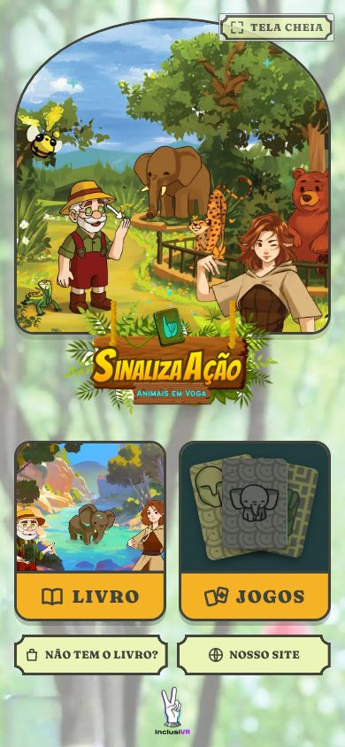
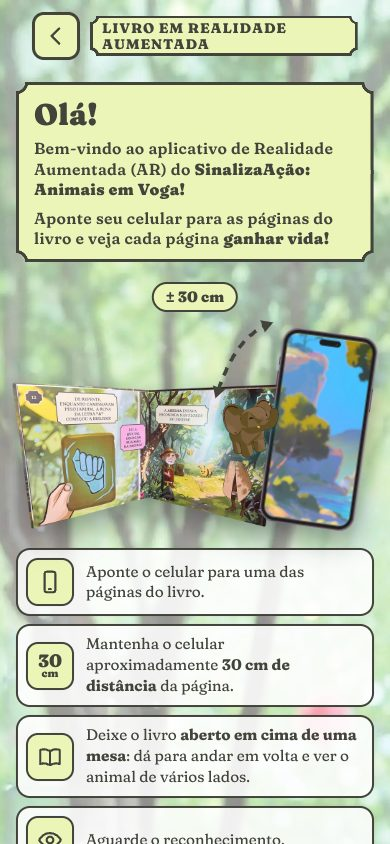
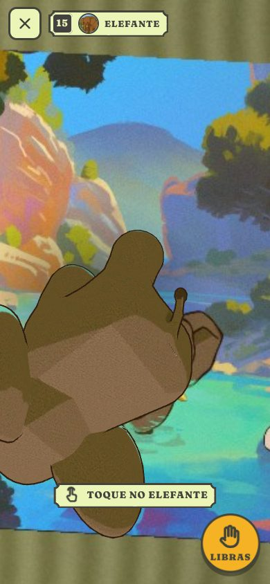
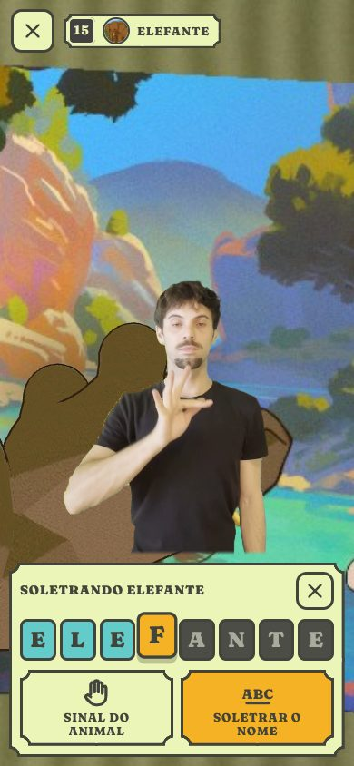
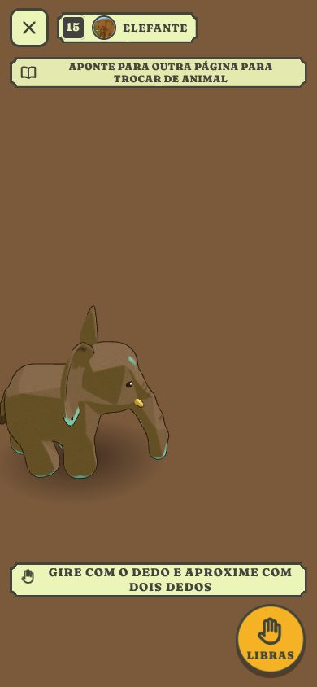
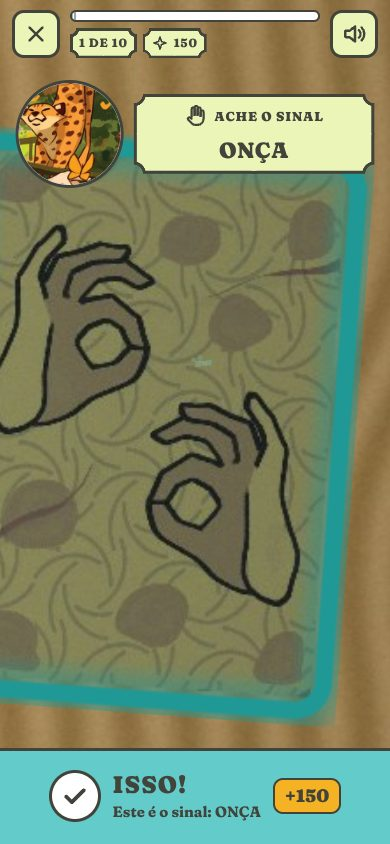
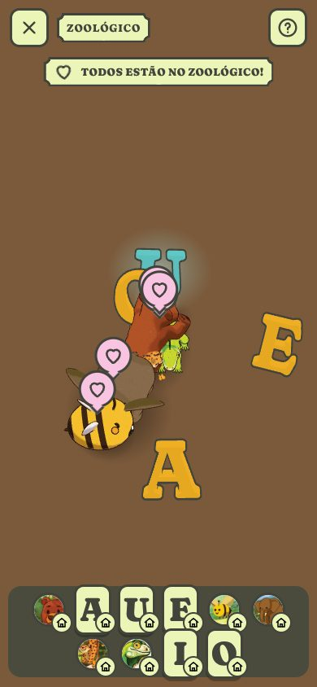
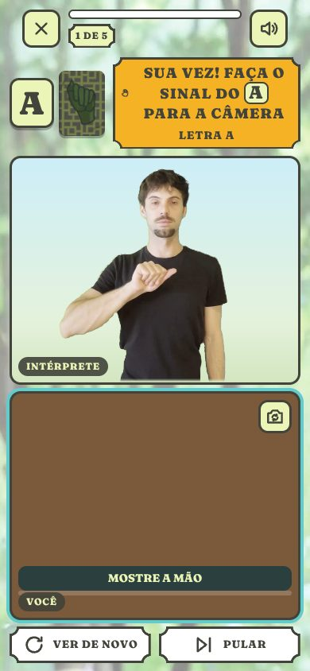
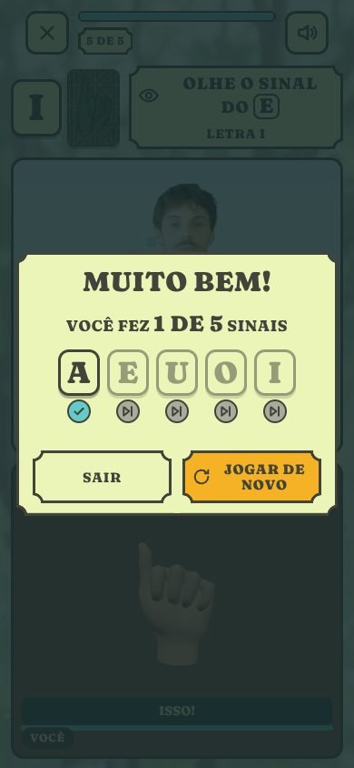

# SinalizaAção: Animais em Voga — WebApp de Realidade Aumentada

O app que dá vida ao livro *SinalizaAção: Animais em Voga* (InclusiVR), para
crianças de 3 a 8 anos — muitas ainda sem saber ler. Roda no navegador do
celular (Android e iPhone), sem instalar nada.

- **LIVRO** — aponte o celular para uma página com AR: o animal (traço do Igor
  Bucioli, em 3D) **salta do desenho**, fica feliz e **passeia pela página**,
  acompanhando-a com **movimento liso**. Tocar nele é **carinho**. A página é o
  **validador**: se a câmera sai dela, o animal **desliza para o palco de
  brincar**, no meio da tela, e a brincadeira continua (girar com um dedo,
  aproximar com dois). A mesma página voltou: ele volta para ela. O botão
  **LIBRAS** chama o **intérprete de LIBRAS**: **SINAL DO ANIMAL** (repete
  quantas vezes quiser) e **SOLETRAR O NOME** (cada letra destacada em
  sincronia, como karaokê).
- **JOGOS**:
  - **Jogo de Cartas** — o jogo mostra o animal (ou a letra) e a criança acha,
    entre as cartas com a face de LIBRAS para cima, **o sinal que combina**.
    Embaralha **uma vez por partida** (com semente); errar não tira pontos.
  - **Zoológico (em AR)** — cada **carta** mostrada para a câmera, em qualquer
    posição, traz o seu animal para o zoológico (um palco no meio da tela), e a
    carta do **sinal de uma vogal** traz a **letra** do português, em 3D. Todos
    brincam juntos (o urso come o mel da abelha, o elefante joga água, a onça
    brinca, a letra acende quando o seu animal chega); a **casinha** leva
    alguém para descansar. Sem a página 22 desde a versão 2.2.
  - **Sinalize!** — o jogo mostra uma **vogal**; o intérprete faz o sinal
    **duas vezes**, e a criança repete para a **câmera frontal**, com calma:
    **sem pontos e sem tempo**, só "ISSO!" e "QUASE!". O jogo precisa da câmera
    e **não grava imagens**.
- **TELA CHEIA** e **MÚSICA** na tela inicial (a música é a trilha do sound
  design; entra quando o arquivo estiver no app).

Tudo no navegador: [MindAR](https://github.com/hiukim/mind-ar-js) (imagens),
[Three.js](https://threejs.org/) r160 (3D) e [MediaPipe](https://ai.google.dev/edge/mediapipe) (mãos).
Visual: **Telas do Signária** do design system InclusiVR.

> **Versão 2.2 (10/11/2026):** a Maga Aia e o Seu Zé em 3D foram **arquivados**
> (voltam no futuro). O que saiu e como trazer de volta: **[docs/ARQUIVO.md](docs/ARQUIVO.md)**.

> **Regra (10/11/2026, vale para todos os produtos):** o app nunca mostra o nome
> de ninguém da equipe. Aparece a **função** ("o intérprete de LIBRAS"), que é o
> que importa para quem usa. Os nomes ficam só nos créditos deste README. Se um
> dia for preciso citar um nome, ele vem sempre junto com o título ou a função.

| Início | Instruções | Elefante na página | LIBRAS: soletrar |
|---|---|---|---|
|  |  |  |  |

| Palco de brincar (sem a página) | Jogo de Cartas | Zoológico (só cartas) | Sinalize!: sua vez | Sinalize!: fim |
|---|---|---|---|---|
|  |  |  |  |  |

O que mudou na atualização de novembro de 2026, a análise feita antes e o que
depende de material: **[docs/ATUALIZACAO-2026-11.md](docs/ATUALIZACAO-2026-11.md)**.

---

## 1. Como abrir

**Publicado:** a câmera só funciona em `https://`. Com o GitHub Pages ativado
(seção 11), a raiz redireciona para `inclusiapp/`.

**No computador, para desenvolver:**

```bash
npm install
npm start            # http://localhost:8080/inclusiapp/
```

## 2. Estrutura

```text
inclusiapp/
├── index.html                 telas (início, livro, jogos) + ícones de linha (SVG)
├── sw.js                      service worker (VERSION: aumente ao publicar mudanças grandes)
├── src/
│   ├── config.js              ★ animais, páginas do livro, palco de brincar, música, pares das cartas, AR
│   ├── main.js · router.js    rotas: #/ #/livro #/livro/ar #/sala #/cartas #/cartas/jogar #/zoo #/zoo/ar #/sinalize #/sinalize/jogar
│   ├── ar/
│   │   ├── arSession.js       câmera + MindAR + Three.js (renderer único do app); busca focada e alvos ignorados
│   │   ├── targets.js         alvos .mind comprimidos, com verificação
│   │   ├── bookAR.js          o livro: a página valida → o animal segue a página ou vai para o palco + LIBRAS
│   │   ├── poseFollower.js    movimento liso (segue a página a cada quadro) e o palco de brincar (sem DOM — testado)
│   │   ├── gestures.js        girar, aproximar e mover com os dedos (no palco); toque curto = carinho
│   │   ├── debugHud.js        medidor da equipe (?debug=1): quadros e rastreio por segundo
│   │   ├── pageActor.js       a vida na página: saltar, passear, carinho, ir para casa
│   │   ├── pageWalker.js      o passeio dentro da página (sem DOM — testado)
│   │   ├── modelManager.js    animais .glb (meshopt) e as animações gravadas
│   │   └── videoChroma.js     vídeo do intérprete sem o fundo verde (trechos, com pausa no fim)
│   ├── lib/download.js        downloads com progresso (barra "chegando...") e pré-carga
│   ├── libras/
│   │   ├── librasVideos.js    ★ tempos de cada letra e do sinal em cada vídeo
│   │   └── librasPanel.js     o módulo do intérprete (SINAL / SOLETRAR em karaokê)
│   ├── game/                  Jogo de Cartas (gameState.js = regras, random.js = semente)
│   ├── zoo/                   Zoológico em AR (zooConfig.js ★ cartas e interações, zooState.js = regras,
│   │                          zooAR.js = as cartas validam e trazem todos ao palco, letterModel.js = letras 3D)
│   ├── sign/                  Sinalize! (signConfig.js ★, signRecognizers.js, handSigns.js...)
│   ├── ui/                    menu, jogos, instruções, avisos, sons, música, tela cheia, faíscas
│   └── styles/                tokens.css (design system) · signaria.css (componentes) · app.css (telas)
├── assets/
│   ├── models/*.glb           os 5 animais (repositório inclusivr-animais)
│   ├── targets/               paginas.mind (as 5 páginas da primeira versão), cartas.mind (20 faces: jogo e zoológico)
│   ├── musica/                a trilha (musica.json diz qual arquivo toca)
│   ├── zoo/letras.json        contorno das vogais 3D (tools/gerar-letras.py)
│   ├── img/                   arte final do Igor e do design system, em WebP (instrucoes/: fotos do site + o elefante do app)
│   └── fonts/                 Fraunces Soft (substituta livre da Cooper; OFL)
├── vendor/                    MindAR 1.2.5, Three.js r160 (+ meshopt, SkeletonUtils), MediaPipe 1.0.1
└── cartas/ pag/ videos/ exemplo/ codes/      arquivos originais
tools/                         servidor, alvos (compile-targets), imagens, foto do animal (render-instrucoes), letras 3D, medição dos vídeos de LIBRAS
tests/                         testes de unidade, de reconhecimento e ponta a ponta
```

## 3. Configuração central — `inclusiapp/src/config.js`

- `ANIMALS`: cada animal com modelo, retrato (recorte da ilustração do Igor),
  as duas faces da sua carta (`picture` e `sign`), as animações e a letra.
- `BOOK_PAGES`: **as páginas que têm AR** — alvo no `paginas.mind`, número da
  página no livro, o animal e onde ele está desenhado (`home`, de onde ele salta).
- `STAGE`: o **palco de brincar** (a página invisível no meio da tela): inclinação,
  tamanho, altura e a área do passeio.
- `BOOK`: amortecimento do movimento (`smoothMs`), quando ir para o palco
  (`stageAfterMs`) e a duração da viagem (`glideMs`).
- `MUSIC`: volume e entrada da música (o arquivo é escolhido em `assets/musica/musica.json`).
- `CARD_PAIRS`: os 10 pares do Jogo de Cartas (o que o jogo mostra → a face de
  LIBRAS que a criança precisa achar).
- `LIBRAS` (chroma key), `GAME` (pontuação do Jogo de Cartas), `AR` (rastreamento).

| Página do livro | Alvo | Animal |
|---|---|---|
| 13 | 0 (`pag/Pagina1.png`) | Abelha |
| 15 | 1 | Elefante (o da lagoa, com o reflexo turquesa) |
| 17 | 2 | Iguana |
| 19 | 3 | Onça |
| 21 | 4 | Urso |

São as mesmas 5 páginas (e o mesmo arquivo `paginas.mind`) da primeira versão
do app. As páginas da Aia e do Seu Zé foram arquivadas na 2.2 (`docs/ARQUIVO.md`).

A **runa** (a página da esquerda, com textura) não tem AR: o reconhecimento é
pelo desenho do animal, na página ao lado. As cartas recortadas têm AR só nos jogos.

## 4. Os animais

- **Animais** (`inclusivr-animais`, aprovados em 29/10/2026): `.glb` leves
  (malha e animações com meshopt, textura WebP), material sem luz com a pintura
  do Igor. Animações gravadas: `parado`, `andar` (a abelha: `voar`), `feliz` e a
  especial — `agua` (elefante), `crista` (iguana), `brincar` (onça), `mel`
  (urso). O app não troca o material; toca os clipes com `AnimationMixer`.
- **No livro** (`pageActor.js`): salta do desenho (`feliz`), passeia sem sair
  da página e espia a beirada; toque = carinho (`feliz`), a cada 3 toques a
  especial.
- **Movimento liso** (`poseFollower.js`): o rastreio muda a pose da página só
  10 a 20 vezes por segundo, e a tela é desenhada 60. O animal fica num grupo
  que **segue** a página a cada quadro, com amortecimento curto
  (`BOOK.smoothMs`). Assim ele não anda "aos saltinhos" nem treme quando vira
  para a câmera.
- **Palco de brincar**:
  - sem a página, o grupo viaja (`BOOK.glideMs`) até uma página invisível no meio da tela (`STAGE`), e o animal continua passeando, sem sair da tela;
  - um dedo gira, dois aproximam (`gestures.js`, do "Modo Interação" da primeira versão);
  - duplo toque fora do animal volta ao início.

Para trocar um modelo: copie o novo `.glb` para `assets/models/` com o mesmo
nome (o contrato está no `docs/ENTREGA.md` do `inclusivr-animais`) e confira em
`tools/model-viewer.html`.

## 5. LIBRAS com o intérprete

Cada vídeo (`videos/<animal>.mp4`) tem a **soletração** e depois o **sinal**
(gravado 2 a 4 vezes). `src/libras/librasVideos.js` guarda onde começa e
termina cada letra e o sinal. Os tempos foram medidos com
`node tools/medir-libras.mjs` (o reconhecimento de mãos acha as pausas da mão)
e conferidos quadro a quadro. **Falta o intérprete conferir** (`conferido: false`).

- O módulo só aparece pelo botão **LIBRAS**, nas páginas com animal.
- **SINAL DO ANIMAL** toca só o trecho do sinal; **DE NOVO** repete.
- **SOLETRAR O NOME** toca a soletração e destaca a letra da vez (âmbar); as
  anteriores ficam ciano e as próximas, de pedra.
- O chroma key do fundo verde-limão está em `LIBRAS.chroma` (seção 7 do histórico).
- Nada fica por cima do vídeo (nem sombra, nem fundo): as mãos aparecem
  inteiras, acima do painel.
- As **vogais sozinhas** (Sinalize!) começam com a mão chegando e terminam
  ainda na vogal, antes da letra seguinte (o U de URSO não mostra o R), e o
  vídeo para um pouco na vogal (`VOWEL_CLIPS`, medido quadro a quadro).

## 6. Alvos do MindAR (páginas e cartas)

```bash
npm run targets          # compila páginas e cartas (lê as pastas pag/ e cartas/)
npm run targets -- paginas
```

Reconhecimento medido com o detector real do MindAR em fotos sintéticas
(`python3 tests/make_frames.py` e `node tests/e2e/recognition.mjs`):

| Conjunto | Resultado |
|---|---|
| 5 páginas × 4 situações (de frente, inclinada, longe, escura) | **100%**, 0 confusões |
| 20 faces das cartas | 98,8% (medição anterior) |

Os nomes dos arquivos de referência (`livro_p15`...) contam 2 páginas a mais
que o livro impresso.

O **zoológico** usa o mesmo `cartas.mind` do Jogo de Cartas (carta N = alvo
N−1), e o mesmo reconhecimento (o celular prepara uma vez só).

**Rastreamento no livro**: os ajustes do filtro e das tolerâncias são os da
primeira versão (`AR.book`). Ao perder a página, por 1,5 s o MindAR procura só
aquela página (`BOOK.refocusMs`), o que reencontra mais rápido quem abaixa o
celular para ver o animal de lado.

**Medidor no celular**: abra com `?debug=1` (ex.: `…/inclusiapp/?debug=1`). No
canto aparece "desenho X/s · rastreio Y/s · alvos": se o "desenho" cai, o
aparelho está pesado; se só o "rastreio" cai, o gargalo é o reconhecimento.

## 7. Jogo de Cartas

As cartas físicas têm duas faces: o desenho (animal ou letra) e o sinal em
LIBRAS. O jogo mostra uma face e pede a **outra face da mesma carta** — a
criança precisa relacionar o animal ao seu sinal, não achar a mesma imagem.

- Dica na tela: deixar todas as cartas com o **lado do sinal para cima**.
- Mostrou o desenho do mesmo par? "VIRE A CARTA!". Outra carta? "QUASE!" (sem perder pontos).
- Acerto: 100 pontos + até 50 de rapidez; "ISSO!" e o próximo desafio na hora.
- Embaralha **uma vez** no começo (semente nova a cada partida; a ordem fica
  fixa e continua igual se o jogo for retomado). 10 desafios; resumo com 1 a 3 estrelas.

## 8. Zoológico (em AR)

Um jogo de realidade aumentada com as cartas. Desde a versão 2.2, **sem a
página 22**: com muitas cartas em cima, a página ficava tampada e o rastreio
se perdia (teste da equipe, 10/11/2026).

- Mostre uma **carta** para a câmera, **em qualquer posição** (girada, de lado,
  de cabeça para baixo): a carta só **valida**. O animal (as duas faces da
  carta valem) **salta do lugar da carta** para o zoológico, um "chão"
  invisível no meio da tela (o mesmo palco do livro). A carta do **sinal de uma
  vogal** (ou a da letra) traz a **letra do português em 3D**, animada.
- Um de cada: no máximo **5 animais + 5 letras**. A carta usada sai da procura
  (as duas faces), e o celular acha logo a próxima. Com os 10 no zoológico, o
  reconhecimento das cartas **para** (o celular só desenha: 101 mil triângulos,
  30 chamadas de desenho).
- **Carinho**: toque. Um dedo gira o zoológico, dois aproximam.
  **Casinha** (no lugar da lixeira): leva alguém para descansar; a carta volta a valer.
- **Necessidades** em balões com ícones, sem barras: o urso sente **fome de
  mel**; os outros **querem brincar**; depois aparecem **feliz** e **satisfeito**.
- **Interações** (`src/zoo/zooConfig.js`, só o que a história mostra; páginas do
  livro impresso): urso + abelha → a abelha voa até ele e o urso come mel (pág. 21);
  o elefante joga água em quem chega (pág. 15); a onça brinca (pág. 19); outros
  encontros = os dois ficam felizes (pág. 22); de tempos em tempos um animal vai
  visitar a sua letra ou um amigo; **o animal perto da letra da sua inicial** →
  a letra acende em turquesa e ele faz a animação especial.
- As letras ficam sempre viradas para quem segura o celular.
- Se no celular não ficar fluido, o caminho para arquivar está em `docs/ARQUIVO.md`.

## 9. Sinalize!

```text
a vogal na tela (a letra + a carta do sinal) → OLHE: o intérprete faz o sinal 2 vezes
→ "SUA VEZ! FAÇA O SINAL DO A PARA A CÂMERA" (câmera frontal), sem pressa
→ reconhecido: "ISSO! VOCÊ FEZ O A!" → próxima
→ outra vogal na câmera: "QUASE! OLHE DE NOVO O SINAL DO A NA CARTA" (e continua tentando)
fim: "VOCÊ FEZ 4 DE 5 SINAIS", com cada vogal
```

**Sem pontos e sem tempo** desde a versão 2.2 (pedido da equipe): o relógio
passava a ideia de fazer rápido, e o reconhecimento funciona melhor com calma.
Sem contagem 3-2-1, sem tempo limite, sem recordes. Depois de 12 s sem
acertar, aparece **uma** dica (a mão inteira na câmera, com luz); nada se perde.

- **Só as 5 vogais** (configurações de mão paradas, que a câmera reconhece bem).
  Os sinais dos animais têm movimento e saíram do jogo (10/11/2026); as regras
  provisórias deles estão no histórico do git (commit `9ceda81`), para o Signária IA.
- O jogo **precisa da câmera** (não há ACERTEI/ERREI, que davam para trapacear).
  Sem câmera, explica o que fazer e diz que **não gravamos imagens**.
- A tela ocupa a altura do aparelho: vídeo e câmera dividem o espaço e os
  botões ficam sempre à vista, sem rolar.
- Câmera **frontal** por padrão, espelhada; botão para trocar. Sem esqueleto da
  mão na tela e sem termos técnicos.
- **Vogais**: classificador da configuração de mão (`handSigns.js`) + juiz de
  vários quadros (`signJudge.js`), conferidos com a mão 3D e com os vídeos do intérprete.

## 10. Visual e acessibilidade

- **Telas do Signária** (design system InclusiVR): plaquinhas de pergaminho com
  cantos recortados e contorno tinta, botão principal âmbar embaixo, ciano para
  acerto e progresso, rosa para dica e "quase", Fraunces Soft, fundo com a
  floresta esmaecida do Igor. **Sem emoji**: ícones de linha no `index.html`.
- **Para quem ainda não lê**: cada instrução tem ícone e imagem; os jogos
  começam com uma demonstração em passos visuais; os retratos dos animais e as
  runas são a arte do Igor. Os textos continuam lá para quem lê e para os adultos.
- Leitores de tela (anúncios), foco visível, alvos de toque grandes, "reduzir
  movimento" respeitado, retorno visual de todo som.
- **Abertura**: a cena do livro com todos no zoológico (a ilustração do Igor),
  numa janela em arco, com o logo por cima. A tela inicial **cabe inteira** em
  qualquer celular, sem rolar: a janela usa o espaço que sobra, e a marca da
  InclusiVR fica sempre à vista. **TELA CHEIA** nos cantos (só onde o navegador
  deixa: o Safari do iPhone não deixa) e **MÚSICA** (quando houver o arquivo).
- **Instruções do livro**: a foto do livro aberto e o celular (do site da
  InclusiVR), com o elefante **do app** saltando da página para o celular
  (`tools/render-instrucoes.mjs` fotografa o `.glb`), e "± 30 cm". Sem pessoa.
- **Música**: a trilha do sound design, em laço e baixinha
  (`src/ui/music.js`). Para ligar ou trocar: ponha o MP3 em `assets/musica/`
  (nome sem acento nem espaço) e escreva o nome em `assets/musica/musica.json`.
- **Sons**: provisórios, gerados na hora (kalimba, madeira e um brilho), no
  lugar dos bipes genéricos da primeira versão. Quando o sound design (Luigi)
  entregar os arquivos, é só pôr em `assets/sons/` e listar em `ARQUIVOS`
  (`src/ui/sound.js`).

## 11. Publicar no GitHub Pages

**Settings → Pages → Deploy from a branch** → a branch e a pasta **/ (root)**.
Ao publicar mudanças grandes, aumente `VERSION` em `inclusiapp/sw.js`.

## 12. Testes

```bash
npm test                         # 96 testes de unidade
python3 tests/e2e/make_zoo_frames.py   # fotos sintéticas do zoológico (cartas em várias posições)
python3 tests/make_frames.py     # (opcional) fotos sintéticas das páginas e cartas
node tests/e2e/recognition.mjs   # reconhecimento real das páginas e cartas
npm run test:e2e                 # ponta a ponta no Chromium (telas, livro, cartas, zoo, sinalize, erros, paisagem)
npm run test:e2e -- livro        # só uma parte
```

Os testes ponta a ponta usam uma **câmera falsa** (`tests/e2e/fakeCamera.js`):
o caminho real (câmera → MindAR/MediaPipe → 3D → LIBRAS) roda no navegador.
Verificam, entre outros:
- nenhum nome da equipe no app, e nenhuma menção à Aia ou ao Seu Zé;
- o início cabe sem rolar em 6 tamanhos; TELA CHEIA; a música (com um tom de teste);
- as fotos das instruções; o intérprete não aparece sozinho; o karaokê destaca a letra certa;
- no livro:
  - o animal segue a página pelo grupo liso;
  - sem a página, ele vai para o palco e continua lá (carinho e giro com o dedo);
  - a página volta e ele volta;
  - outra página: ele se despede;
- a face do desenho não vale no Jogo de Cartas;
- o zoológico só com cartas:
  - de cabeça para baixo, de lado e duas juntas;
  - os 10 juntos, com o reconhecimento parado, e a casinha;
- o Sinalize:
  - sem placar nem tempo, com "QUASE!" numa vogal errada sem tapar os botões;
  - "ISSO!" na certa e "VOCÊ FEZ 1 DE 5";
  - sem rolar em 360×640, e sem câmera = aviso;
- câmera desligada ao sair;
- mensagens de câmera negada, ocupada ou inexistente;
- sem rolagem lateral em paisagem, tablet e computador. Os testes de unidade conferem o reconhecedor com as medidas reais
dos vídeos do intérprete (`tests/fixtures/libras/medidas.json.gz`).

`CHROMIUM_PATH=/caminho/do/chrome` usa um Chromium já instalado.

O servidor de teste (`tools/serve.mjs`) comprime os arquivos como o GitHub
Pages (gzip, com o `Content-Length` comprimido), para os testes verem o mesmo
que o celular (`SEM_GZIP=1` desliga).

## 13. Compatibilidade e desempenho

- Android (Chrome) e iPhone/iPad (Safari, iOS 15+); computador com webcam.
- Sem CDN: bibliotecas, fontes e modelos ficam no próprio site.
- Tudo sob demanda: os animais (95–427 KB cada) baixam em segundo plano quando
  o livro abre (sem "economia de dados"), com barra de progresso se a página
  aparecer antes; o reconhecimento de mãos (≈ 19 MB) só no Sinalize. O service
  worker guarda tudo.
- Um único contexto WebGL para o livro, os jogos e o vídeo do intérprete.

## 14. Problemas comuns

| Sintoma | Solução |
|---|---|
| "Precisamos acessar sua câmera" | permita a câmera: Android — cadeado → Permissões; iPhone — **aA** → Ajustes do Site |
| Página não reconhecida | é uma das páginas com AR? (veja a tela de instruções) ~30 cm, página inteira, boa luz |
| Apontei para a runa e nada | a runa sozinha não tem AR: aponte para o desenho do animal ao lado |
| Sinal não reconhecido no Sinalize | lugar iluminado, a mão inteira na tela; use **VER DE NOVO** ou **PULAR** |
| Zoológico: a carta não traz ninguém | a carta inteira na câmera, com luz, a uns 20 cm; uma de cada vez |
| O animal "trava" ou some no livro | abra com `?debug=1` e veja o medidor; boa luz ajuda o rastreio. Sem a página, ele fica no palco (é o esperado) |
| Não aparece o botão TELA CHEIA | o navegador não deixa (Safari do iPhone): use "Adicionar à Tela de Início" |
| Letra do karaokê fora do tempo | ajuste os números em `src/libras/librasVideos.js` |

## 15. Créditos e licenças

- Ilustrações, cartas, vídeos, animais 3D e fotos do livro: InclusiVR —
  ilustrador: Igor Bucioli; intérprete de LIBRAS: Fauston Zandoná; diagramação
  do livro: Nina Nunes; sound design (a trilha): Luigi.
- [MindAR](https://github.com/hiukim/mind-ar-js) 1.2.5 — MIT · [Three.js](https://threejs.org/) r160 — MIT ·
  [MediaPipe Tasks Vision](https://github.com/google-ai-edge/mediapipe) 1.0.1 — Apache-2.0.
- Fonte [Fraunces](https://github.com/undercasetype/Fraunces) (Fraunces Soft) — SIL Open Font License.
- Só nos testes: mão 3D "generic-hand" do WebXR Input Profiles — MIT.
